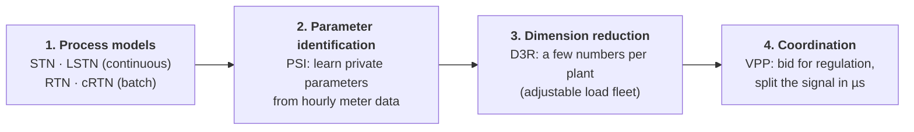
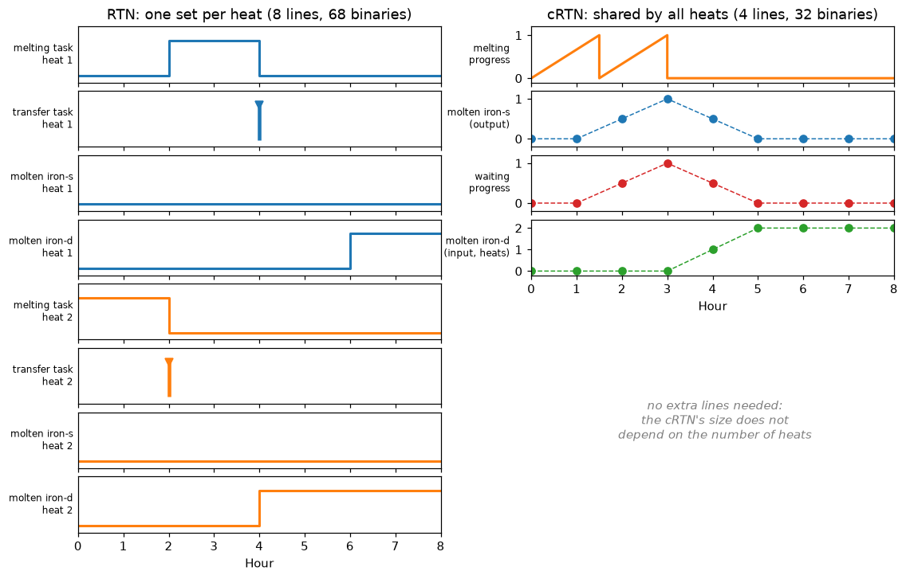

# indflex

**Industrial demand flexibility: from process models to grid decisions.**

*(formerly the Industrial User Modeling Toolkit)*

Open models and teaching notebooks for **industrial demand flexibility**: how to model what a factory can do, learn it from meter data, compress it, and operate it together with other flexible resources. The toolkit follows the chain of the PhD thesis *Industrial Load Modeling and Optimization for Market-Based Interaction with Power Systems* (Ruike Lyu, Tsinghua University) and its papers. Every step has a Python implementation checked against the original paper code, and an interactive notebook that runs in seconds to a few minutes.





## The notebooks

| Step | Notebook | What you will see | Runtime | Solver |
|---|---|---|---|---|
| 1 | [`01_stn_vs_lstn`](notebooks/01_stn_vs_lstn.ipynb) | Interactive schedules; time-in-state turns a MILP into an LP; 200 factories in seconds | ~1.5 min | HiGHS |
| 1 | [`02_rtn_vs_crtn`](notebooks/02_rtn_vs_crtn.ipynb) | Rounding error of whole-slot tasks; 8 per-heat RTN lines vs. 4 shared cRTN lines; Gantt charts; binaries vs. heats | ~2 min | HiGHS |
| 2 | [`03_psi`](notebooks/03_psi.ipynb) | Inverse optimization recovers a plant's rated powers and production target from meter data; a demand-response what-if | ~10 s | Gurobi* |
| 3 | [`04_d3r`](notebooks/04_d3r.ipynb) | A cement plant's 192 binaries reduced to 4 numbers; error on unseen prices | ~10 s | HiGHS |
| 4 | [`05_vpp`](notebooks/05_vpp.ipynb) | Bidding LP for 135 resources; duals → merit order; following the RegD signal | ~15 s | HiGHS |

\* PSI's inverse problem is nonconvex (bilinear) and needs Gurobi with a full license (free for academics). Everything else runs with the free [HiGHS](https://highs.dev) solver.

Each step has a concept page in [`docs/`](docs/README.md): the idea, what the model can and cannot claim, the main figures, results checked against the paper code, and links to the paper, code and video.

## Quickstart

```bash
git clone https://github.com/ruikelyu/indflex.git
cd indflex
pip install -e ".[dev]"            # add ",gurobi" for notebook 03
jupyter lab notebooks/
```

```python
import indflex as fx

# 1. process models
plant = fx.load_plant("steel_powder_lu2021")                    # data/plants/*.yaml
price = fx.daily_price("2022-07", day=23)                       # PJM real-time, $/MWh
stn, lstn = fx.solve(fx.build_stn(plant, price)), fx.solve(fx.build_lstn(plant, price))

steel = fx.load_batch_plant("steelmaking_zhang2017")
crtn = fx.solve(fx.build_crtn(steel, price.repeat(2), n_heats=2, dt=0.5))

# 2. identification, 3. reduction
from indflex.identify import make_meter_dataset
from indflex.reduce import fit_alf, simulate_alf
data = make_meter_dataset(fx.load_plant("cement_golmohamadi2020"))
alf, info = fit_alf(data.price_train[:3], data.load_train[:3], n_loads=1)   # free MILP

# 4. coordination
from indflex.coordinate import load_vpp_case, bid, merit_order, allocate
case = load_vpp_case("day21")
bids = bid(case)                                                 # LP; bids.lam = value of stored energy
```

## Papers, original code and videos

| Step | Paper | Original code | Video |
|---|---|---|---|
| LSTN | R. Lyu et al., *IEEE ISGT Europe*, 2023 ([slides](https://github.com/ruikelyu/indflex/releases/tag/slides-lstn-isgt2023)) | [`matlab/lstn/`](matlab/lstn) | [YouTube](https://youtu.be/wMm-IgvIvhM) |
| cRTN | R. Lyu et al., "Efficient Scheduling of Discrete Industrial Processes through Continuous Modeling," *IEEE Trans. Smart Grid*, in press ([link](https://ieeexplore.ieee.org/document/11082423)) | [repo](https://github.com/ruikelyu/Efficient-Scheduling-of-Discrete-Industrial-Processes) | [YouTube](https://youtu.be/RATnHWVbLwY) · [Bilibili](https://www.bilibili.com/video/BV1cdurzbEgi) |
| PSI | R. Lyu et al., "Production Scheduling Identification…," *IEEE Trans. Smart Grid* 16(2), 2025 | [repo](https://github.com/ruikelyu/Production-Scheduling-Identification) | [YouTube](https://youtu.be/gpxkEAigneE) · [Bilibili](https://www.bilibili.com/video/BV1bXQDYcE8Y) |
| D3R | R. Lyu et al., "Data-Driven Dimension Reduction for Industrial Load Modeling Using Inverse Optimization," *IEEE Trans. Smart Grid* 16(3), 2025 | [repo](https://github.com/ruikelyu/Data-Driven-Dimension-Reduction) | [YouTube](https://youtu.be/ClJwRWYXZfI) · [Bilibili](https://www.bilibili.com/video/BV1JFQ1YwEsK) |
| VPP | Q. Chen, R. Lyu et al., "Real-Time Operation Strategy of Virtual Power Plants With Optimal Power Disaggregation Among Heterogeneous Resources," *Applied Energy* 361, 2024 | [repo](https://github.com/ruikelyu/Real-time-operation-strategy-of-virtual-power-plants) | [YouTube](https://youtu.be/dFsv5i7JZIM) · [Bilibili](https://www.bilibili.com/video/BV1CpQDYDE67) |

The YouTube videos are two-minute English explainers rendered by `tools/videos/`. The paper repositories remain the reference for reproducing each paper exactly; this toolkit holds the teaching versions. [Reproducibility notes](docs/notes_on_paper_code.md) list the differences and pitfalls found while porting.

## Repository layout

- `src/indflex/`: the Python package
  - `models/`: STN, LSTN, RTN, cRTN
  - `identify/`: PSI
  - `reduce/`: D3R
  - `coordinate/`: VPP
  - `solve.py`, `viz.py`: solver wrapper (HiGHS or Gurobi) and plots
- `notebooks/`: one interactive notebook per step (sources in `tools/build_notebooks.py`)
- `docs/`: concept pages and figures
- `data/`: plain-text inputs. Plants (YAML), PJM prices and factory fleets (CSV), the VPP case (JSON and RegD signal)
- `tests/`: the Python models checked against the original MATLAB code (`tests/fixtures`, regenerated by `tools/matlab_reference/` and `tools/convert/paper_fixtures.py`)
- `tools/`: notebook and figure builders; `tools/videos/` renders a ~2-minute narrated explainer video per step; `tools/convert/` turns the original MATLAB-era data into the plain-text files in `data/`
- `matlab/`: the original MATLAB/YALMIP implementations of STN, LSTN and RTN ([`matlab/README.md`](matlab/README.md))

## Citation

If this toolkit helps your work, please cite the thesis, and the paper for the step you use (table above):

```bibtex
@phdthesis{lyu2026industrial,
  author = {Ruike Lyu},
  title  = {Industrial Load Modeling and Optimization for Market-Based Interaction with Power Systems},
  school = {Tsinghua University},
  year   = {2026},
  month  = jun
}
```

See also [`CITATION.cff`](CITATION.cff).

---

## Original MATLAB implementations

The original MATLAB/YALMIP implementations of the State-Task Network (STN), Linear State-Task Network (LSTN) and Resource-Task Network (RTN) are in [`matlab/`](matlab/README.md) (`stn/`, `lstn/`, `rtn/`). They need MATLAB, YALMIP and a commercial solver (Gurobi or CPLEX).

Feel free to raise issues or submit PRs if you have any questions or suggestions. Thank you for your interest and support!

# indflex：工业需求侧灵活性工具包

**从工业过程模型到电网决策。**（原名 Industrial User Modeling Toolkit）

## 简介
本工具包提供工业用户需求侧灵活性的开源模型和交互式教学笔记本，覆盖博士论文 *Industrial Load Modeling and Optimization for Market-Based Interaction with Power Systems*（清华大学）的完整技术链条：

1. **工业过程建模**：连续生产过程的 STN / LSTN，离散（批次）生产过程的 RTN / cRTN；
2. **参数辨识（PSI）**：基于逆优化，从逐小时电表数据辨识工厂的私有参数；
3. **数据驱动降维（D3R）**：用少量参数的可调负荷集群（ALF）近似复杂的工业过程模型；
4. **聚合运行（VPP）**：虚拟电厂参与调频市场的投标，以及基于对偶变量的微秒级功率分解。

每一步都有 Python 实现（`src/indflex/`），并与论文原始 MATLAB 代码逐一核对（`tests/`）；`notebooks/` 中的笔记本可在几秒到几分钟内运行完毕。除参数辨识需要 Gurobi 外，其余均可使用免费求解器 HiGHS。各步骤的原理说明见 `docs/`。

## 文件结构
- `src/indflex/`：Python 工具包
- `notebooks/`：每个步骤一个交互式笔记本
- `docs/`：原理说明与图片
- `matlab/`：状态任务网络（STN）、线性状态任务网络（LSTN）和资源任务网络（RTN）的原始 MATLAB 实现

如果您有任何疑问或建议，欢迎提出问题或提交 PR。感谢您的关注和支持！
