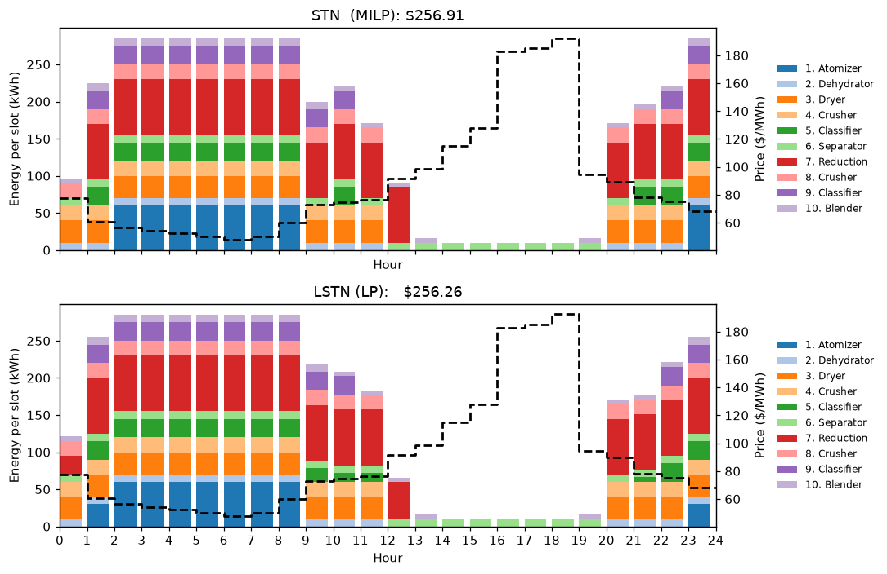
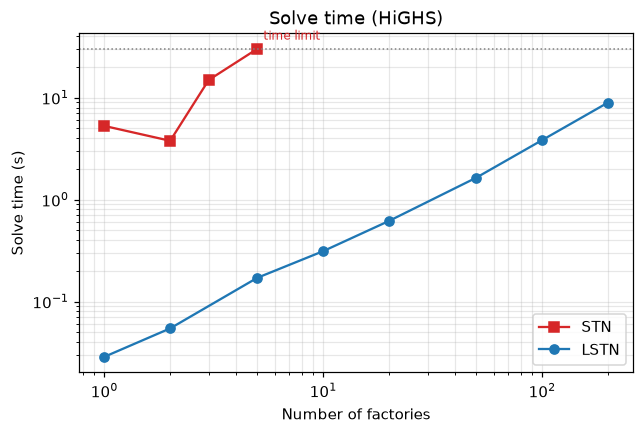

# 1 · Continuous processes: STN and LSTN

**Notebook:** [`notebooks/01_stn_vs_lstn.ipynb`](../notebooks/01_stn_vs_lstn.ipynb) (about 1.5 min, free HiGHS solver)
**Code:** `indflex.build_stn`, `indflex.build_lstn`, `indflex.build_fleet` ([`src/indflex/models/continuous.py`](../src/indflex/models/continuous.py))

## The idea

Continuous processes (crushing, grinding, cement, steel powder) are serial production lines: each machine has a few operating modes (off, half, full) and the buffers between machines let upstream stages run ahead while power is cheap. A **State-Task Network (STN)** schedules this with a binary variable per machine, mode and hour, which is a MILP.

Market intervals (an hour) are much longer than the time a machine needs to switch modes. The **LSTN** therefore asks *how long* each machine spends in each mode during the hour, not *which* single mode it is in. The binaries become fractions in $[0, 1]$ that add up to one, and the scheduling problem becomes an **LP**.

$$
\min \sum_t \pi_t \sum_n E_{n,t}, \quad E_{n,t} = \sum_p e_{n,p}\, x_{n,p,t}\, \Delta t, \quad \sum_p x_{n,p,t} = 1, \quad
x_{n,p,t} \in \{0,1\}\ \text{(STN)} \ \text{or}\ [0,1]\ \text{(LSTN)}
$$

plus buffer balances, buffer capacities and an end-of-day production target.

## What it is, and what it is not

* The LSTN's cost is a **lower bound** on the STN's. For the steel powder plant it is within 1% on every day of July 2022 (0.4% on average); hourly load profiles differ by about 4% on average.
* The LSTN removes **every** binary for continuous processes. Batch processes need more structure (see [cRTN](02_rtn_crtn.md)).

## Scaling

With the free HiGHS solver, the STN reaches a 30 s time limit at about 5 randomized factories, while the LSTN schedules 200 in about 10 s. With a commercial solver, the paper schedules 2,000 LSTN factories in minutes, while the STN fails to converge within 2 h for 20.

## Checked against the original code

Seven cases (steel powder STN and LSTN, cement STN on three days, the original `LSTN_model.m`, a 5-factory fleet) match the MATLAB/YALMIP code to the cent; see `tests/test_continuous_models.py` and `tools/matlab_reference/make_reference.m`.

## References

* R. Lyu, H. Guo, Y. Zheng, Y. Bai, Q. Chen, "LSTN: A Linear Model of Industrial Production Process for Demand Response," *IEEE ISGT Europe*, 2023.
* Thesis Ch. 2. Plant data: R. Lu et al., *Appl. Energy* 283 (2021) 116291 (steel powder); H. Golmohamadi et al., *IEEE Trans. Ind. Electron.* 67(2), 2020 (cement).
* Original MATLAB code: [`matlab/lstn/`](../matlab/lstn), [`matlab/stn/`](../matlab/stn).
