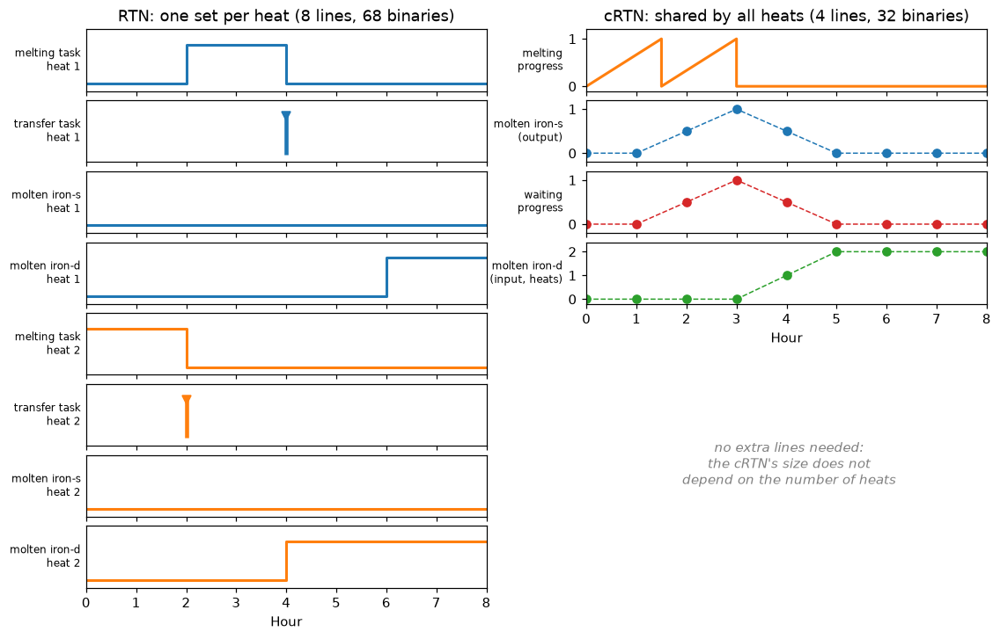
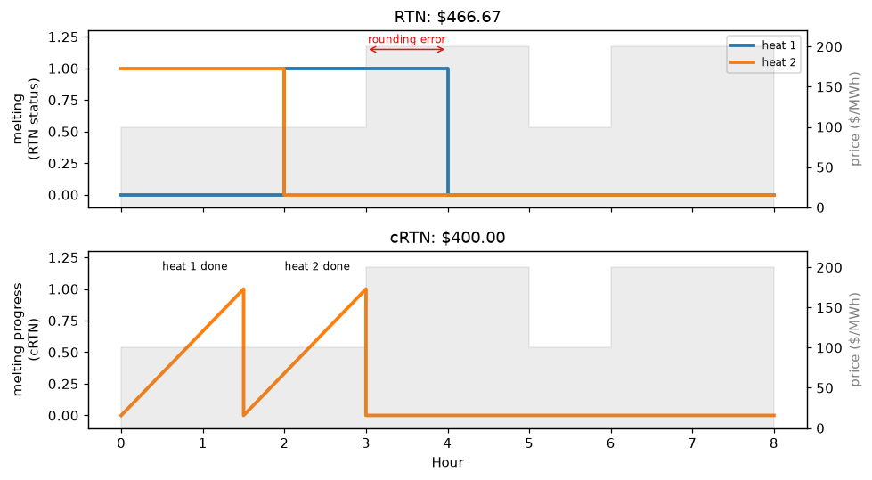
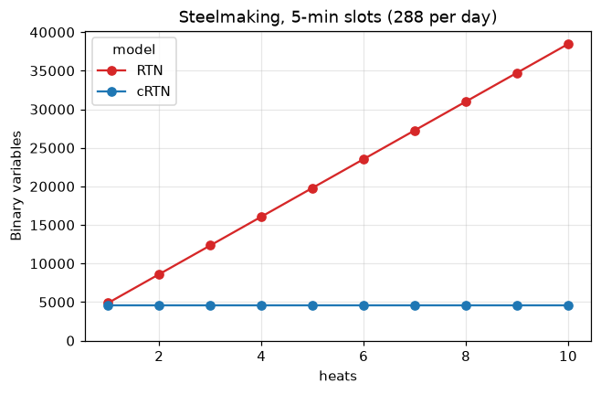
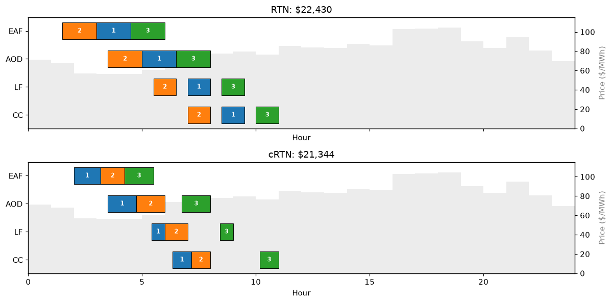

# 2 · Batch processes: RTN and cRTN

**Notebook:** [`notebooks/02_rtn_vs_crtn.ipynb`](../notebooks/02_rtn_vs_crtn.ipynb) (about 2 min, free HiGHS solver)
**Code:** `indflex.build_rtn`, `indflex.build_crtn`, `indflex.models.heat_schedule` ([`src/indflex/models/batch.py`](../src/indflex/models/batch.py))

## The idea

Steelmaking processes discrete **heats** through serial stages (EAF → AOD → LF → CC). Two features make it hard: a heat cannot be interrupted once melting starts, and a hot heat may only wait so long between stages. The conventional **Resource-Task Network (RTN)** models this with a binary *start* variable for every task **and every heat**, so the model grows with the production target. It also rounds every task duration up to whole time slots.

The **continuous RTN (cRTN)** decouples tasks and resources from heats. One processing task per stage tracks the *progress* of the current heat (0 → 1), and virtual output, waiting and input tasks move heats between stages. As in the LSTN, the decision is how long each task runs at each operating point within a slot. Only a few status binaries remain, and their number does not depend on the number of heats.

## Rounding error

In the one-furnace example of the paper (2 heats, flexible power), the cRTN melts each heat in 1.5 h at high power. The RTN can only finish tasks at slot boundaries, so the second heat spills into an expensive hour: **\$466.67 vs. \$400**.

## Model size and solve time

At the paper's 5-minute resolution, the RTN grows from 4,883 to 38,462 binaries for 1–10 heats; the cRTN stays at 4,608. In the paper (Gurobi, 5-minute slots, 8 heats, 15 days of July 2022), the mean solve time falls from **156.7 to 17.1 minutes (−89%)**. With HiGHS at 30-minute slots, the cRTN overtakes the RTN at about 4 heats; at 6 heats the RTN hits a 45 s limit while the cRTN solves in about 9 s.

## What it is, and what it is not

* The cRTN **reduces** binaries; it does not remove them all (the LSTN does, for continuous processes).
* With few heats or coarse slots, the RTN is small too and may solve faster. The cRTN's advantage is about growing problems.
* The cRTN fixes how long a task runs within a slot, not its exact start time; Gantt charts place it by convention.
* The STN is a special case of the RTN, and the LSTN a special case of the cRTN (thesis Ch. 2 §2.5.5).

## Checked against the original code

Eleven cases (the small case in two scenarios; steelmaking at 30- and 15-minute slots with 1–3 heats; RTN and cRTN) match the MATLAB code exactly; see `tests/test_batch_models.py` and `tools/matlab_reference/make_reference_crtn.m`.

## References

* R. Lyu, X. Su, E. Du, H. Guo, Q. Chen, C. Kang, "Efficient Scheduling of Discrete Industrial Processes through Continuous Modeling," *IEEE Trans. Smart Grid*, in press ([IEEE Xplore](https://ieeexplore.ieee.org/document/11082423)). Video: [Bilibili](https://www.bilibili.com/video/BV1cdurzbEgi).
* Paper code: [Efficient-Scheduling-of-Discrete-Industrial-Processes](https://github.com/ruikelyu/Efficient-Scheduling-of-Discrete-Industrial-Processes).
* Plant data: X. Zhang, G. Hug, I. Harjunkoski, "Cost-Effective Scheduling of Steel Plants With Flexible EAFs," *IEEE Trans. Smart Grid* 8(1), 2017.
