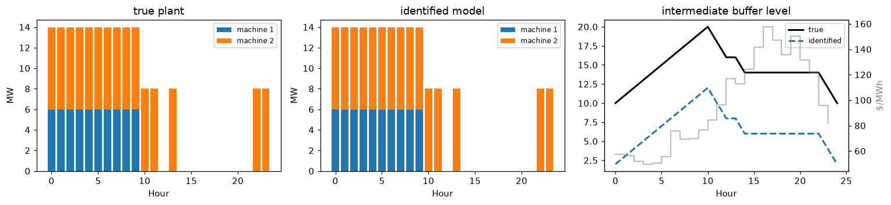
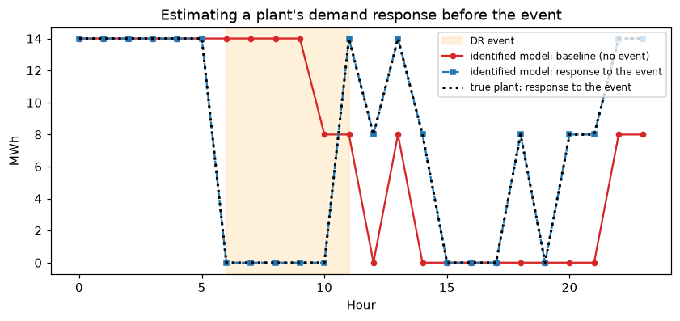

# 3 · Parameter identification: PSI

**Notebook:** [`notebooks/03_psi.ipynb`](../notebooks/03_psi.ipynb) (about 10 s; needs Gurobi with a full license, free for academics)
**Code:** `indflex.identify.build_inverse_day`, `train_psi`, `make_meter_dataset`, `target_from_energy` ([`src/indflex/identify/psi.py`](../src/indflex/identify/psi.py))

## The idea

A grid operator or aggregator sees a factory's **hourly meter data** and the **prices** it faced, but not its process parameters. Production Scheduling Identification (PSI) assumes the factory minimizes its electricity cost subject to a modified STN (mSTN), and asks which parameters

$$\theta = (P^{\max},\ S^{0},\ S^{\rm tar},\ S^{\max})$$

make that *optimal* schedule reproduce the meter data. The energy per unit of product at each stage ($g_i$) is an industry figure and treated as known.

**Inverse optimization.** Write the mSTN's optimality conditions (primal feasibility, dual feasibility, strong duality) as constraints, let θ be decision variables, and minimize the squared misfit to the meter data. Strong duality multiplies dual variables by θ, so the problem is nonconvex (bilinear); Gurobi's `NonConvex=2` solves it.

**Iteration, when needed.** For a small plant, one day and one solve recover θ. With many days or larger plants, PSI cycles through the days under a short time limit and, after a first pass, also penalizes the distance from θ to the average of recent estimates (a zeroth-order stochastic method).

## Using the identified model

The identified model predicts the plant's response to prices it has never seen, for example a demand-response event: the baseline without the event and the expected response.

## What it is, and what it is not

* Parameters the data never exercise cannot be identified (for example, the absolute level of a buffer, or the size of a buffer that never fills). They also do not change the predicted load.
* The paper reaches 5.2% (cement) and 8.5% (steel powder) error using Gurobi with **120 s per iteration** for about 210 iterations, i.e. hours per model. With 1 s per iteration, the solver often stops at a trivial "produce nothing" model. A prior from public data avoids that: in a serial line, the daily production target is about *daily energy* / $\sum_i 1/g_i$ (`target_from_energy`). With it, the cement plant reaches 8–14% at 1 s per iteration.

## Checked against the original code

The toolkit's STN (notebook 01) reproduces the paper's cement meter data exactly, and a 2-machine plant is recovered exactly in one solve; see `tests/test_psi.py`. The inverse problem and training loop transcribe the paper code line by line.

## References

* R. Lyu, H. Guo, Q. Tang, Q. Chen, C. Kang, "Production Scheduling Identification: An Inverse Optimization Approach for Industrial Load Modeling Using Smart Meter Data," *IEEE Trans. Smart Grid* 16(2), 1207–1220, 2025. Video: [Bilibili](https://www.bilibili.com/video/BV1bXQDYcE8Y).
* Paper code: [Production-Scheduling-Identification](https://github.com/ruikelyu/Production-Scheduling-Identification).
* Thesis Ch. 3.
