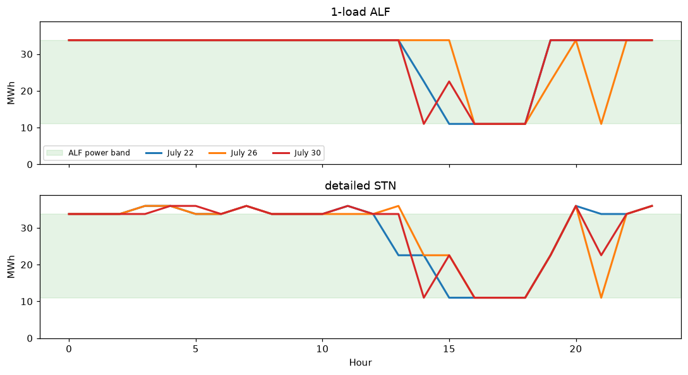
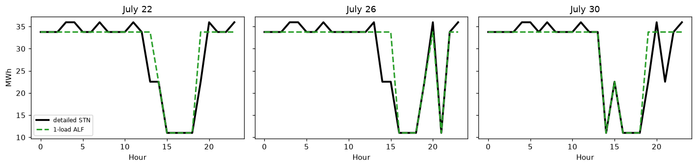

# 4 · Dimension reduction: D3R

**Notebook:** [`notebooks/04_d3r.ipynb`](../notebooks/04_d3r.ipynb) (about 10 s, free HiGHS solver)
**Code:** `indflex.reduce.fit_alf`, `train_d3r`, `build_alf`, `simulate_alf` ([`src/indflex/reduce/d3r.py`](../src/indflex/reduce/d3r.py))

## The idea

A grid or planning model cannot carry a detailed process model, with its binaries, for every factory, and exact aggregation of many such models is computationally hard. Data-driven dimension reduction (D3R) replaces each detailed model with **reduced constraints** whose *optimal response to prices* mimics the detailed model's.

The reduced form is an **adjustable load fleet (ALF)**: $I$ adjustable loads in parallel, each with hourly power limits and daily energy limits,

$$\underline P_i \le p_{t,i} \le \overline P_i, \qquad \underline E_i \le \textstyle\sum_t p_{t,i}\,\Delta t \le \overline E_i ,$$

i.e. **4 numbers per load**. It keeps the main features of industrial loads: several pieces of equipment, rated powers, and a daily production goal.

**Training** uses inverse optimization, as in PSI: the ALF's KKT conditions become constraints and its parameters become variables. Complementary slackness is linearized with big-M binaries, so there are no bilinear terms. With a squared-error loss the problem is a mixed-integer QP (Gurobi, as in the paper); with an absolute-error loss it is a MILP that the free HiGHS solver handles. Small cases fit in one solve; the paper's code iterates over random batches of days (`train_d3r`).

## Results

| Case | Toolkit (one HiGHS solve, 3 training days) | Paper |
|---|---|---|
| Cement, 1 load | 9.3% (3 s) | 8.9% |
| Cement, 2 loads | 3.1% (57 s) | 9.5% |
| Steelmaking, 1 load | 4.1% (2 s) | 3.6% |

Errors are normalized RMSE of the optimal response on held-out days (July 22–31, 2022). For the steelmaking line, the paper replaces 10,208 integer variables with 24 continuous ones.

## What it is, and what it is not

* D3R errors are errors in **optimal response** under new prices, not feasibility guarantees. The detailed model (or the plant) turns the reduced model's decision into an executable schedule.
* The ALF ignores some temporal coupling between stages; more loads fit better.

## Checked against the original code

With the paper's saved parameters, the toolkit's ALF reproduces the saved steel powder and steelmaking responses exactly, and the paper's error table (8.9%, 10.3%, 3.6%) is recomputed from the saved results; see `tests/test_d3r.py`.

## References

* R. Lyu, H. Guo, G. Strbac, C. Kang, "Data-Driven Dimension Reduction for Industrial Load Modeling Using Inverse Optimization," *IEEE Trans. Smart Grid* 16(3), 2695–2698, 2025. Video: [Bilibili](https://www.bilibili.com/video/BV1JFQ1YwEsK).
* Paper code: [Data-Driven-Dimension-Reduction](https://github.com/ruikelyu/Data-Driven-Dimension-Reduction).
* Thesis Ch. 4. Extension to many distributed resources: R. Lyu, H. Guo, Q. Chen, "Approximating Energy-Regulation Feasible Regions of Virtual Power Plants: A Data-Driven Inverse Optimization Approach," *IEEE PES GM* 2024 ([code](https://github.com/ruikelyu/Approximating-Feasible-Region-of-Virtual-Power-Plants-A-Data-driven-Approach)).
