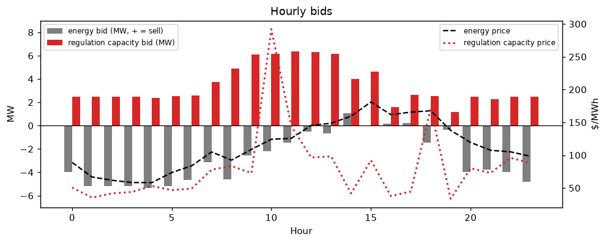
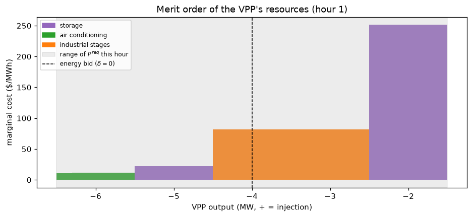
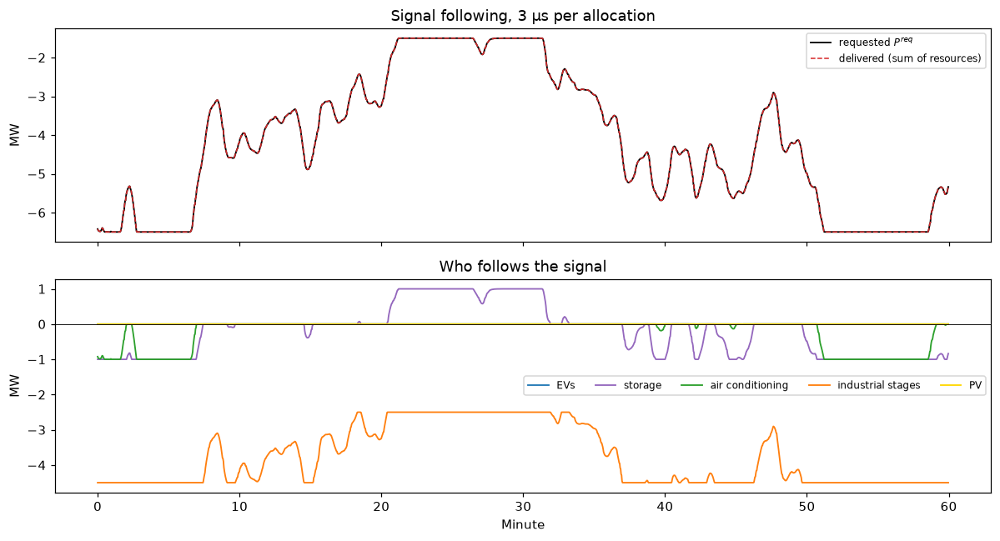

# 5 · Virtual power plant: bidding and fast power disaggregation

**Notebook:** [`notebooks/05_vpp.ipynb`](../notebooks/05_vpp.ipynb) (about 15 s, free HiGHS solver)
**Code:** `indflex.coordinate.bid`, `merit_order`, `allocate`, `simulate_hour` ([`src/indflex/coordinate/vpp.py`](../src/indflex/coordinate/vpp.py))

## The idea

A virtual power plant (VPP) pools many small, different resources (EVs, storage, air conditioning, industrial production stages, PV) and sells energy and frequency regulation. All resources share one **standardized model**: discharge and charge power limits, an energy state with self-loss and efficiencies (off-diagonal efficiencies couple industrial stages through their buffers), external drift and usage costs.

It decides on two time scales:

1. **Bidding (every 30 min).** An LP over the rest of the day chooses hourly energy and regulation bids, planning every resource's power under discretized regulation-signal scenarios with their probabilities.
2. **Disaggregation (every 2 s).** The grid operator sends a signal $\delta$ and the VPP must deliver $P^{\rm req} = P^{\rm bid} + R^{\rm bid}\delta$ at once. The bidding LP's dual variables $\lambda_i = \partial\,\text{profit}/\partial E_i$ price each resource's stored energy, which gives every resource power segments with constant marginal costs. Sorted, they form a **merit order**; filling it up to $P^{\rm req}$ solves the disaggregation LP exactly, in microseconds and without a solver.

## Results

| | Toolkit (HiGHS) | Paper code (MATLAB, Gurobi) |
|---|---|---|
| Day-ahead profit (day 21) | \$3,306.60 | \$3,306.60 |
| Real-time re-bid profit | \$3,350.43 | \$3,350.43 |
| Disaggregation | 3–8 µs (merit order) vs. 3–5 ms (LP) | — |

Bids, duals, the non-regulating schedules and every resource's power over the first minutes match the paper code; see `tests/test_vpp.py`.

## A note on coupled resources

The energy update is $E' = \eta\, p$, so the value of running resource $j$ is $(\eta^\top\lambda)_j$. The paper code uses $(\eta\lambda)_j$; the two differ only for coupled resources (industrial stages). The toolkit uses $\eta^\top\lambda$ by default, and `merit_order(..., eta_convention="paper")` reproduces the paper code exactly. In our tests, the transposed version is never more expensive. See [notes on the paper code](notes_on_paper_code.md).

## References

* Q. Chen, R. Lyu, H. Guo, X. Su, "Real-Time Operation Strategy of Virtual Power Plants With Optimal Power Disaggregation Among Heterogeneous Resources," *Applied Energy* 361 (2024) 122876. Video: [Bilibili](https://www.bilibili.com/video/BV1CpQDYDE67).
* Paper code: [Real-time-operation-strategy-of-virtual-power-plants](https://github.com/ruikelyu/Real-time-operation-strategy-of-virtual-power-plants).
* Predecessor (EVs only, online LP disaggregation): R. Lyu, H. Guo, K. Zheng, M. Sun, Q. Chen, "Co-Optimizing Bidding and Power Allocation of an EV Aggregator Providing Real-Time Frequency Regulation Service," *IEEE Trans. Smart Grid* 14(6), 4594–4606, 2023 ([code](https://github.com/ruikelyu/Co-Optimizing-Bidding-and-Power-Allocation-of-an-EV-Aggregator), [video](https://www.bilibili.com/video/BV1u3QDYFEKi)).
* Thesis Ch. 5.
